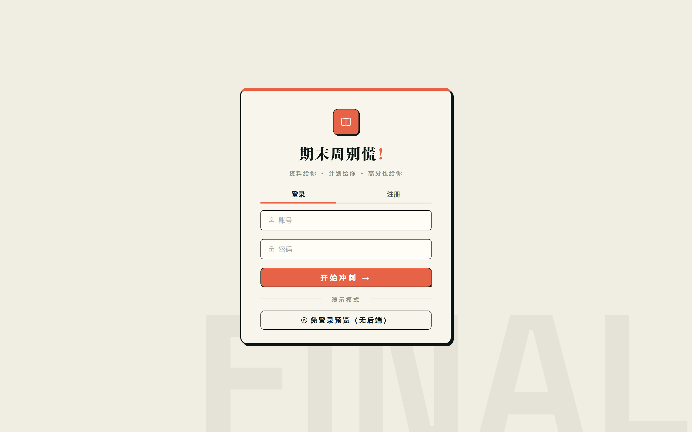
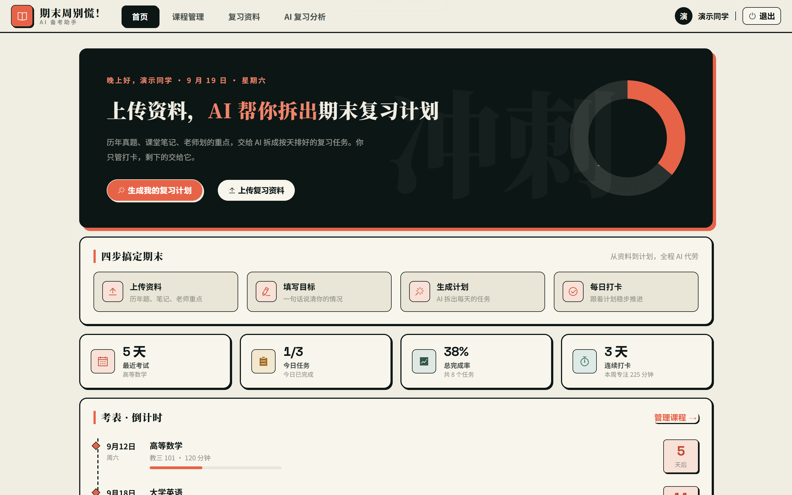
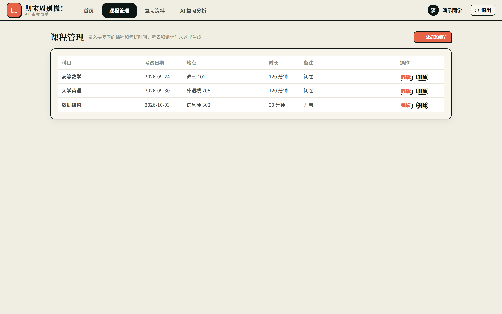
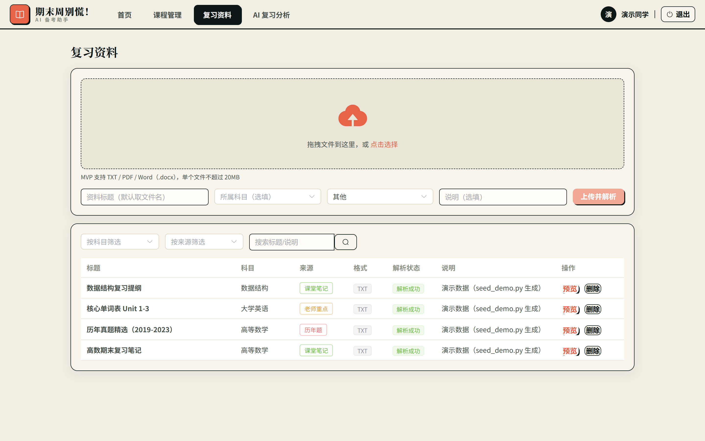
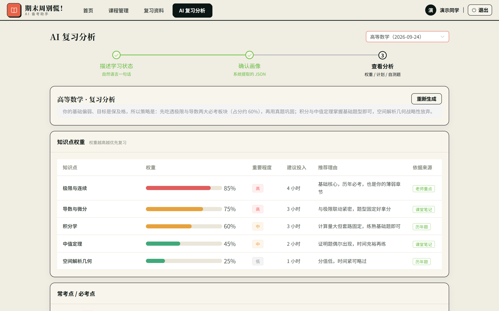

# 📚 期末周别慌！—— AI 智能备考网站

> 四川大学计算机学院 2024 级《问题求解实战》课程 · 刘添屹小组
>
> **一句话**：上传复习资料 + 描述学习状态 → AI 生成个性化复习重点、按天复习计划和自测题 → 每天打卡冲刺期末。
>
> **核心流程**：注册登录 → 录入考试 → 上传资料 → 描述学习状态 → AI 提取画像 → AI 生成分析 → 每日任务打卡 → 首页看倒计时与进度。

**目录**：[界面预览与在线演示](#界面预览与在线演示) · [项目状态一览](#项目状态一览) · [1. 项目简介](#1-项目简介) · [2. 功能总览](#2-功能总览谁要做什么看这张表) · [3. 核心业务逻辑](#3-核心业务逻辑动手实现前必读) · [4. 技术栈](#4-技术栈) · [5. 目录结构](#5-目录结构) · [6. 本地运行](#6-本地运行) · [7. 演示主线](#7-演示主线答辩就讲这条线) · [8. 小组分工](#8-小组分工) · [9. 团队协作约定](#9-团队协作约定组员与-ai-助手必读) · [10. 项目文档索引](#10-项目文档索引) · [11. 常见问题](#11-常见问题) · [12. 修改记录](#12-修改记录)

---

## 界面预览与在线演示

**在线演示（GitHub Pages）**：<https://danielliu1219.github.io/fmzh/> —— 当前部署源码与时间见[版本信息](https://danielliu1219.github.io/fmzh/version.json)。打开后点「免登录预览」即可体验首页、课程管理、复习资料、AI 复习分析、统计与周报等页面；演示使用内置数据，刷新后恢复示例，完整功能请按第 6 节在本地启动前后端。

| 登录 | 首页 |
|---|---|
|  |  |

| 考试管理 | 复习资料 | AI 复习分析 |
|---|---|---|
|  |  |  |

截图为实际运行界面（首页截图为本地预览数据，其余页面为真实后端数据）。

---

## 项目状态一览

- **需求分析已完成并交付**：需求分析文档 V1.7 共 104 页，9 个模块 59 个用例、70 张 UML 图、数据字典、73 条需求对照记录（**课程交付文档不随本仓库发布**，67 条用户需求全文已并入本文档第 2 节）
- **代码已完成骨架与核心流程**：注册登录 → 录入考试 → 上传复习资料 → 描述学习状态 → AI 提取画像 → 生成分析 → 计划落为每日任务 → 打卡看进度，本地可完整跑通（默认 Mock 模式，不需要申请 API Key）
- **功能清单已打通，交付收尾中**：当前 59 个用例中 **59 个已打通、0 个基础版、0 个完全待开发**，功能覆盖率 100%，不代表全部验收完成。每日压力记录、日历、学习时段推荐、真正半天减负及重要确认均已补齐；已完成通用全科排程并发一致性，确认时统一重验，模型等待期间输入变化则拒绝旧结果，分析与任务原子保存。已完成统一启动、同源生产构建、干净环境回归和重启持久化验收。大模型 API 配置入口保留待填，真实调用路径验收仍保留为交付待办。现有 10 档分数区间、绩点对应及滑条吸附规则保持不变。具体见第 2 节；验收和下一步统一维护在本地 `PROJECT_HANDOFF.md`。

**最终交付标准**：除用户填写后端真实大模型 API 配置外，其余功能、真实前后端联调、运行配置与必要验收应完成。功能清单100%仅表示用例打通；全科排程并发、本地运行交付和干净环境验收已完成，真实大模型调用路径仍待验收。API配置保留待填，本轮不接入真实平台。GitHub Pages仍是静态演示，完整后端尚未托管到公网。

---

## 1. 项目简介

「期末周别慌！」是面向大学生期末复习场景的一站式智能备考网站。学生上传历年题、老师划的重点、课堂笔记、作业练习等多源复习资料，用一句话描述自己的备考目标与学习状态，系统调用大模型分析常考必考内容、计算知识点权重，为不同目标和基础的学生生成**差异化**的复习方案、按天计划与自测题；配套任务打卡、统计图表、压力指数、救急模式等功能，帮助学生在期末周科学高效地复习。

### 项目亮点（需求分析定稿的创新点）

1. **两级权重体系** —— 把「资料权重」（按来源类型衡量资料可信度）与「知识点权重」（按历年题必考点衡量知识点重要性）分离，分析结果既有依据又有个性；
2. **画像驱动的差异化方案** —— 用自然语言描述学习情况，配合川大绩点对应的目标分数区间与学习表单建立画像；基础薄弱者优先核心内容，目标较高者增加综合应用，不同用户得到不同复习策略；
3. **历年题驱动的考点分析** —— 大模型重点提取历年题中的必考题与常考题型，复习重点与自测题贴合真实考试；
4. **人文关怀功能** —— 期末压力指数、临时救急模式、今日最重要的三件事、情绪记录，缓解考前焦虑。

### 核心设计思路

1. **分析对象就是用户上传的资料** —— 历年题、老师划的重点、PPT、课堂笔记、作业、练习题，系统不去网上搜资料。这样更贴近期末复习的真实场景，也避免大模型随意发挥；
2. **用结构化输入管住大模型** —— 「用户输入结构化 + 固定提示词 + 限制输出格式」三件套，让分析结果稳定、可复现；
3. **自然语言先转成固定 JSON**，作为后续分析的依据：

```json
{
  "target": "pass",
  "learning_status": "weak",
  "available_days": 5,
  "daily_hours": 3,
  "weak_chapters": ["极限", "积分"],
  "materials": ["历年题", "老师重点", "PPT"],
  "output_need": ["知识点权重", "复习计划", "自测题"]
}
```

4. **大模型输出也是固定格式** —— 知识点列表、权重分析、常考必考判断、推荐依据、个性化计划、自测题，每一项都有约定好的结构。

---

## 2. 功能总览（谁要做什么，看这张表）

系统功能需求共 **9 个模块、59 个用例**，完整定义见课程提交的需求分析文档；67 条用户需求全文见本节末尾。状态含义：

> 状态按当前实现记录（2026-10-30）。静态演示的部署版本见页首「版本信息」；线上使用内置演示数据，涉及数据库、文件解析和大模型的真实行为需启动本地前后端验证。✅ 已打通，🔧 基础版，⬜ 待开发；未完成部分不勾选。

| 状态 | 含义 |
|---|---|
| ✅ | 已实现，前后端主流程已打通；不代表全部上线验收均已完成 |
| 🔧 | 已有基础版，但仍有需求或缺陷未补齐；具体差距写在对应行 |
| ⬜ | 尚未实现，即**待开发任务**（对应行列出负责人） |

### 模块 1 · 账号管理

| 用例 | 功能 | 逻辑要点 | 状态 | 负责人 |
|---|---|---|---|---|
| 1.1 | 注册账号 | 校验账号格式与唯一性，密码 bcrypt 哈希存储 | ✅ | — |
| 1.2 | 登录系统 | JWT 签发；连续 3 次失败锁定账号 | ✅ | 许丽媛 |
| 1.3 | 账号锁定与解锁 | 连续 3 次失败自动锁定，30 分钟自动解锁；经密码找回可立即解锁 | ✅ | 许丽媛 |
| 1.4 | 密码找回 | 输入账号+学号验证身份，重置密码后自动解锁 | ✅ | 许丽媛 |
| 1.5 | 修改密码 | 登录状态下验证原密码后设置新密码，哈希存储 | ✅ | 许丽媛 |
| 1.6 | 编辑个人资料 | 头像/姓名/专业/年级/班级 | ✅ | 许丽媛 |
| 1.7 | 注销账号 | 注销清理全部个人数据及上传文件；仍被其他账号引用的共享文件保留 | ✅ | 许丽媛 |

### 模块 2 · 考试与日程管理

| 用例 | 功能 | 逻辑要点 | 状态 | 负责人 |
|---|---|---|---|---|
| 2.1 | 首页聚合视图 | 今日待办 + 考试倒计时 + 总进度 + 连续打卡 | ✅ | — |
| 2.2 | 录入考试安排 | 科目/日期/地点/时长 | ✅ | — |
| 2.3 | 修改/删除考试安排 | 关联任务/分析/自测/问答/提醒原子清理；资料转未分类，专注保留科目快照与历史分钟数 | ✅ | — |
| 2.4 | 筛选查看考试列表 | 按科目/日期筛选 | ✅ | 许丽媛 |
| 2.5 | 创建备考计划与学习任务 | 起止时段、地点、难度与复习内容持久化；每天/周一至周五/每周有限重复，先预览再批量保存，每项可独立编辑和打卡；旧任务兼容 | ✅ | — |
| 2.6 | 编辑/删除学习任务 | 编辑或删除已有任务 | ✅ | 许丽媛 |
| 2.7 | 倒推生成备考时间表 | 按考试日期倒推每日安排 | ✅ | 许丽媛 |
| 2.8 | 任务冲突检测 | 跨科同日真实时段交集，首尾相接允许、未定时不推测；创建/编辑/改期/重复日期及 ICS 批内外预检，保存时账号写锁内重验，冲突不写入；另保留日预算提醒 | ✅ | 许丽媛 |
| 2.9 | 日历视图与拖拽调整 | 日/周/月切换、独立科目筛选、未定时区与24小时时间轴；跨日/时段拖动保留时长，精确调整兼容键盘和窄屏；真实后端检查快照/预算/截止日/冲突，成功后更新，失败保留原安排 | ✅ | 许丽媛 |
| 2.10 | 番茄钟与每日学习目标 | 番茄钟计时、计入专注时长 | ✅ | 张诗琪 |
| 2.11 | 科目颜色标签 | 每科固定颜色，全站统一 | ✅ | 许丽媛 |
| 2.12 | ICS 导入 | 预览不写库，确认校验全科预算/截止日/快照，事务保存与重复确认去重；重复规则需先展开单次事件 | ✅ | 许丽媛 |
| 2.13 | ICS 导出 | 文本转义、UTF-8 折行、UTC 时间及全天事件边界；保留任务真实时段/地点/内容，未定时任务明确标注 08:00 占位 | ✅ | 许丽媛 |

### 模块 3 · 复习资料管理

| 用例 | 功能 | 逻辑要点 | 状态 | 负责人 |
|---|---|---|---|---|
| 3.1 | 上传复习资料 | 选科目 + 来源类型，后端解析 PDF/Word/TXT 文本 | ✅ | — |
| 3.2 | 资料标注与来源识别 | 七类来源：历年试题/老师重点/平时作业/课堂笔记/教材章节/实验报告/练习题 | ✅（七类来源 + 文件名/正文辅助识别建议 + 权重档位 高/中/低） | 胡歆桐 |
| 3.3 | 资料分类整理 | 按科目/类型归档成综合资料库 | ✅ | 胡歆桐 |
| 3.4 | 全文搜索与筛选 | 检索解析正文，按科目/标签/日期/类型筛选排序 | ✅ | 胡歆桐 |
| 3.5 | 收藏与错题本 | 收藏资料、自测错题自动入本，去重并支持答案与解析回看 | ✅ | 胡歆桐 |
| 3.6 | 合并导出复习笔记 | 多份资料合并导出 Markdown/PDF | ✅（PDF 走浏览器「另存为 PDF」） | 胡歆桐 |

### 模块 4 · AI 智能分析（核心模块）

| 用例 | 功能 | 逻辑要点 | 状态 | 负责人 |
|---|---|---|---|---|
| 4.1 | 用户画像采集 | 自然语言+目标区间滑条 → 固定 JSON；未选课展示公共界面，选课后加载本科画像，可重新编辑 | ✅ | — |
| 4.2 | 复习资料权重计算 | 按来源层级给默认权重，学生可手动调整 | ✅（默认层级 + 资料编辑弹窗手动调整，AI 分析按权重参考） | 胡歆桐 |
| 4.3 | 知识点与复习提纲提取 | 大模型从资料提取知识点清单与复习提纲 | ✅ | — |
| 4.4 | 思维导图与记忆卡片生成 | 提纲可视化 + 卡片式背诵 | ✅（ECharts 提纲导图 + 翻面背诵卡片，背面取资料原文） | 胡歆桐 |
| 4.5 | 资料问答 | 就资料内容向大模型提问 | ✅（多轮追问 + 会话历史持久化，回答仅依据上传资料） | 胡歆桐 |
| 4.6 | 自测题生成与自动判分 | 客观题生成、作答提交、后端判分、解析与历史得分，错题自动入本 | ✅ | 张诗琪 |
| 4.7 | 常考题型与高频考点分析 | 从历年题提取题型分布与高频考点 | ✅（题型占比图 + 出现次数排序；缺题型数据时按考点描述兜底推断） | 胡歆桐 |
| 4.8 | 知识点权重计算 | 历年题必考点定基础值，画像调整 → 复习优先级 | ✅ | — |
| 4.9 | 知识点可视化 | 权重/来源/建议时长与掌握状态；按最近覆盖该知识点的已交卷自测计算，≥80% 已掌握，无记录未测，支持查看判分依据 | ✅ | 胡歆桐 |
| 4.10 | 个性化复习方案生成 | 按画像生成按天计划，自动落为首页任务 | ✅ | — |
| 4.11 | 分级推荐策略 | 保留 10 档分数/绩点规则；按目标、学习基础、薄弱章节和剩余天数分配基础/常见题/综合训练，分钟守恒、同日累计限额、超额提示；真实后端保存与反馈重排同步 | ✅ | 胡歆桐 |
| 4.12 | 动态调整计划与权重 | 按本科最近自测/打卡调整权重并追加专项练习；预览全科安排，校验过期快照、预算与截止日，原子保存 | ✅ | 胡歆桐 |
| 4.13 | 推荐依据解释 | 知识点/考点/题型可查看来源资料、真实页码/段落/行与高亮原文，支持跳转资料库；引用核对、变更失效与无匹配提示 | ✅ | 胡歆桐 |
| 4.14 | 大模型输出约束与免责提示 | 资料范围提示词 + 结构化 JSON 校验 + 页面复习参考提示 | ✅ | 胡歆桐 |

### 模块 5 · 学习统计

| 用例 | 功能 | 逻辑要点 | 状态 | 负责人 |
|---|---|---|---|---|
| 5.1 | 任务打卡 | 打卡/撤销，首页进度实时联动 | ✅ | — |
| 5.2 | 学习统计图表 | 独立统计页（`views/Stats.vue`）：近 7/14/30 天 × 各科时长柱状图 × 时长趋势 × 各科完成率 × 历史学习记录报表；新增 `GET /stats/overview`（`/stats/{examId}` 仍在） | ✅ | 张诗琪 |
| 5.3 | 备考周报 | 独立周报页（`views/WeeklyReport.vue`）：近 7 天任务完成率 × 专注时长 × 大模型各科掌握度评分 × 每日记录 × 按周翻页 × Markdown 导出；新增 `POST /reports/weekly`（按需生成） | ✅ | 张诗琪 |

### 模块 6 · 提醒通知

| 用例 | 功能 | 逻辑要点 | 状态 | 负责人 |
|---|---|---|---|---|
| 6.1 | 考前与任务提醒 | 逐项设置基准时刻与提前量；打开/刷新检查到期，首页及通知中心展示，改期跟随、幂等去重 | ✅ | 张诗琪 |
| 6.2 | 通知管理 | 通知历史、已读/未读、全部已读、删除、总开关与考试/任务分类开关，按用户隔离 | ✅ | 张诗琪 |

### 模块 7 · 特色功能（公式见第 3 节）

| 用例 | 功能 | 逻辑要点 | 状态 | 负责人 |
|---|---|---|---|---|
| 7.1 | 期末压力指数 | 保留实时公式与分档；后端按北京时间每天00:05后自动保存快照，启动补当天，账号/日期唯一；首页区分实时值和每日记录，可查近7日实际历史与缺失日期 | ✅ | 宋跃月 |
| 7.2 | 临时救急模式 | 时间紧张时聚焦高频基础考点；可手动开启或由压力指数触发 | ✅ | 宋跃月 |
| 7.3 | 考前重点回顾列表 | 考前按权重列出必看清单 | ✅ | 宋跃月 |
| 7.4 | 今日最重要的三件事 | 按权重+截止时间+压力指数选出置顶 | ✅ | 宋跃月 |
| 7.5 | 学习时段推荐 | 近28天专注区间去重/交集统计，全科或单科查看、历史依据与记录不足说明；复用共享预算，任务打卡单独计数，推荐只读不改排程 | ✅ | 宋跃月 |
| 7.6 | 情绪记录与复习节奏建议 | 每日 1~5 分自评，结合数据给节奏建议；低于 2.5 时给出减负入口（7.7） | ✅ | 宋跃月 |
| 7.7 | 低情绪减负与计划重排 | 上午/下午休息选择，另一半天剩余空档保留待办；真实时段与全科预算约束、固定任务冲突说明、完成历史保护；快照/有效期重验、账号锁内原子确认及失败恢复 | ✅ | 宋跃月 |

### 模块 8 · 管理端功能

| 用例 | 功能 | 逻辑要点 | 状态 | 负责人 |
|---|---|---|---|---|
| 8.1 | 维护课程与科目信息 | 课程/科目基础数据管理 | ✅ | 宋跃月 |
| 8.2 | 管理异常账号与违规内容 | 封禁、内容治理 | ✅ | 宋跃月 |

### 模块 9 · 公共功能（经 include 关系被各业务模块复用，见需求分析 3.3.9）

| 用例 | 功能 | 逻辑要点 | 状态 | 负责人 |
|---|---|---|---|---|
| 9.1 | 身份认证与会话管理 | 登录/找回令牌分用途；改密、重置、退出撤销旧会话，拒绝锁定/封禁账号 | ✅ | — |
| 9.2 | 数据隔离与访问控制 | 业务按用户隔离，账号重建不继承旧数据/会话，自测与错题跨用户访问拒绝 | ✅ | — |
| 9.3 | 重要操作二次确认 | 退出前确认并先保存专注再撤销真实会话；主要表单关闭/离开保护，完整自测判分、重新分析/倒推计划、账号安全与管理员解封/删除、错题移除等确认；取消不写入，进行中操作防离开和重复提交 | ✅ | 宋跃月 |
| 9.4 | 操作日志记录 | 登录、资料变更、AI 分析和重要删除记录结果，管理员分页筛选；保留账号快照，不记录密码/令牌/正文 | ✅ | 宋跃月 |
| 9.5 | 文件上传统一校验 | 扩展名+大小校验（TXT/PDF/DOCX 可解析，≤20MB）+ 后缀与内容头安全扫描；解析失败不阻断上传；PPT/图片解析为扩展方向 | ✅ | 胡歆桐 |

### 用户需求清单（FMZH-USR-0001 ~ 0067）

系统共 67 条用户需求，编号连续无缺号。

- **FMZH-USR-0001** 学生可注册新账号，注册时需提交账号、密码、姓名、学号、专业等信息。
- **FMZH-USR-0002** 系统应校验注册账号的唯一性，当账号已存在时提示用户重新输入。
- **FMZH-USR-0003** 学生可通过账号和密码登录系统。
- **FMZH-USR-0004** 学生连续三次输入错误密码后，系统应锁定该账号并提示用户进行找回或等待解锁。
- **FMZH-USR-0005** 学生可编辑个人资料，包括头像、姓名、专业、年级、班级等信息。
- **FMZH-USR-0006** 学生可注销个人账号，系统应在确认后处理相关用户数据。
- **FMZH-USR-0007** 学生登录后，系统应展示“今日待办”聚合视图，包括考试、任务、提醒和复习进度。
- **FMZH-USR-0008** 学生可录入个人考试安排，包括科目、时间、地点、时长等信息。
- **FMZH-USR-0009** 学生可修改或删除已录入的个人考试安排。
- **FMZH-USR-0010** 学生可查看自己的全部考试安排。
- **FMZH-USR-0011** 系统自动生成考试倒计时并在首页展示。
- **FMZH-USR-0012** 学生可按科目或日期筛选查看自己的考试列表。
- **FMZH-USR-0013** 学生可为各科目创建备考计划，并添加学习任务。
- **FMZH-USR-0014** 学习任务应包含名称、科目、起止时间、地点、优先级、难度等信息。
- **FMZH-USR-0015** 学生可编辑或删除已创建的学习任务。
- **FMZH-USR-0016** 学习任务支持设置重复规则，包括每天、每周和自定义。
- **FMZH-USR-0017** 系统可根据考试时间倒推自动生成备考时间表。
- **FMZH-USR-0018** 系统应自动检测同一时段内的多个任务冲突并提示用户。
- **FMZH-USR-0019** 学生可拖拽调整任务时间，并支持日视图、周视图、月视图切换。
- **FMZH-USR-0020** 学生可为单个任务设置提醒时间。
- **FMZH-USR-0021** 系统应提供番茄钟计时功能帮助学生专注学习。
- **FMZH-USR-0022** 学生可设定每日学习时长目标，系统统计达成情况。
- **FMZH-USR-0023** 学生可为各科目设置颜色标签进行区分。
- **FMZH-USR-0024** 系统支持外部日历 ICS 导入和导出。
- **FMZH-USR-0025** 学生可上传复习资料，支持 PDF、Word、PPT、TXT、图片等格式。
- **FMZH-USR-0026** 系统应校验上传资料的文件格式、大小和安全性。
- **FMZH-USR-0027** 学生上传资料时可添加标题、科目、标签和描述信息。
- **FMZH-USR-0028** 学生可编辑、删除或移动分类已上传的复习资料。
- **FMZH-USR-0029** 学生可上传多种类型的复习信息，包括历年试题、老师标注重点、平时作业、课堂笔记、教材章节、实验报告和练习题。
- **FMZH-USR-0030** 系统应将同一科目的多份资料进行统一整理，形成该科目的综合复习资料库。
- **FMZH-USR-0031** 系统可识别不同资料来源，并区分教师重点、历年题、课堂笔记、作业练习等资料类型。
- **FMZH-USR-0032** 系统可对复习资料进行全文搜索，并按科目、标签、日期和资料类型筛选排序。
- **FMZH-USR-0033** 学生可将重点、错题或高频题标记到“错题本/收藏”。
- **FMZH-USR-0034** 学生可将多份资料合并为一份复习笔记，并导出为 PDF 或 Markdown。
- **FMZH-USR-0035** 系统调用大模型自动提取复习资料中的核心知识点、摘要和复习提纲。
- **FMZH-USR-0036** 系统调用大模型生成思维导图、知识框架、记忆卡片和背诵要点。
- **FMZH-USR-0037** 学生可针对资料向大模型提问并获得解答，系统保存对话历史并支持多轮追问。
- **FMZH-USR-0038** 系统调用大模型根据资料生成自测练习题。
- **FMZH-USR-0039** 系统应基于多来源复习资料综合分析常考题型、必考知识点和高频考点。
- **FMZH-USR-0040** 系统应根据历年题出现频率、教师强调次数、作业覆盖情况和资料标注信息，计算各知识点考试权重。
- **FMZH-USR-0041** 系统应以可视化方式展示每个知识点的重要程度、掌握状态和建议投入时间。
- **FMZH-USR-0042** 系统应允许学生选择备考目标，例如“保及格”“稳中等”“冲高分”等。
- **FMZH-USR-0043** 系统应根据学生的备考目标、剩余时间、历史学习记录和自测结果，生成个性化知识点权重。
- **FMZH-USR-0044** 对于基础薄弱或只求及格的学生，系统应优先推荐高频基础题、必考概念和短期提分内容。
- **FMZH-USR-0045** 对于基础较好且追求高分的学生，系统应推荐综合题、难题、易失分点和拓展考点。
- **FMZH-USR-0046** 系统应根据用户完成任务情况和自测表现动态调整复习计划和知识点权重。
- **FMZH-USR-0047** 系统应解释个性化推荐依据，例如该知识点来自历年高频题、教师重点或用户薄弱项。
- **FMZH-USR-0048** 系统应限制大模型输出范围，使其回答尽量基于用户上传资料、课程资料和考试目标。
- **FMZH-USR-0049** 系统应提示大模型生成内容仅供复习参考，用户需结合教材和课堂要求判断。
- **FMZH-USR-0050** 学生可对学习任务打卡标记完成。
- **FMZH-USR-0051** 系统自动统计各科目学习时长，并以图表展示学习进度和任务完成率。
- **FMZH-USR-0052** 系统生成备考周报或学习总结，结合大模型评测给出各科目掌握程度评分。
- **FMZH-USR-0053** 学生可查看历史学习记录统计报表。
- **FMZH-USR-0054** 系统在考试前和任务开始前发送站内或邮件提醒。
- **FMZH-USR-0055** 学生可自定义提醒方式和提醒时间。
- **FMZH-USR-0056** 学生可查看通知历史，并标记已读、未读或删除。
- **FMZH-USR-0057** 系统可生成“期末压力指数”，综合考试密度、剩余任务量和完成率提示学生调整计划。
- **FMZH-USR-0058** 系统可提供“临时救急模式”，在考试前短时间内生成高优先级冲刺复习清单。
- **FMZH-USR-0059** 系统可根据错题本、收藏内容和高权重知识点生成考前重点回顾列表。
- **FMZH-USR-0060** 系统可提供“今日最重要的三件事”功能，帮助学生降低期末周任务焦虑。
- **FMZH-USR-0061** 系统可根据学生学习习惯推荐适合的学习时间段。
- **FMZH-USR-0062** 系统可提供轻量级情绪记录功能，并根据压力状态给出复习节奏建议。
- **FMZH-USR-0063** 管理员可维护课程、科目和基础考试信息。
- **FMZH-USR-0064** 管理员可管理异常账号和违规内容。
- **FMZH-USR-0065** 所有用户数据应加密存储，普通学生只能访问和管理自己的个人数据。
- **FMZH-USR-0066** 系统应记录关键操作日志，便于问题排查。
- **FMZH-USR-0067** 系统应在删除账号、删除资料等重要操作前进行二次确认。

---

## 3. 核心业务逻辑（动手实现前必读）

这些公式和规则是需求分析里定死的，实现时照抄，不要自己改口径。

### 3.1 两级权重体系

- **资料权重**（衡量「资料可不可信」，默认层级，学生可对单份资料手动调整）：
  `老师标注重点 ＞ 历年试题/练习题 ＞ 平时作业/课堂笔记 ＞ 教材章节/PPT/实验报告`
  默认值（0~1）：老师重点 1.00；历年题/练习题 0.85；平时作业/课堂笔记 0.70；教材章节/实验报告 0.55；其他 0.50。学生可在资料编辑弹窗中调整或恢复默认。
- **知识点权重**（衡量「知识点重不重要」，用于复习计划排序与个性化推荐）：
  历年题必考点分析确定**基础值** → 再按**用户画像**（目标/薄弱章节）调整。

### 3.2 用户画像（结构化 JSON）

自然语言描述 + 学习表单，大模型提取为固定 JSON 字段：**备考目标、学习基础、剩余天数、每日可用时长、薄弱章节**。目标通过区间滑条选择，按[川大教务处本科成绩对照表](https://jwc.scu.edu.cn/info/1066/3444.htm)从及格档（绩点 1.0）到 90–100 分（绩点 4.0），共 10 档；`target_band` 保存明确区间并传入分析，旧 `target` 兼容内部三类策略。未选课程也展示公共输入界面；选课后补充本科信息，已有方案可返回修改画像。画像缺字段时前端引导补全。

### 3.3 期末压力指数（0~100）

```
压力指数 = 30×考试密集度 + 30×任务积压率 + 20×(1−任务完成率) + 20×考试临近度
```

- 考试密集度 = min(1, 未来 7 天考试场次÷4)；任务积压率 = 逾期未完成任务数÷总任务数；任务完成率 = 已完成任务数÷总任务数；考试临近度 = min(1, 21÷最近一场考试剩余天数)
- 分档：<40 轻松、40~60 适中、60~80 偏压、≥80 高压；**≥60 首页提示并建议开启救急模式**
- **边界约定**：无考试时考试密集度与考试临近度取 0；考试当天（剩余 0 天）临近度取 1；无任务时任务积压率与任务完成率取 0
- 后端运行期间按北京时间每天00:05后自动保存当日快照（每分钟检查），无需打开页面；启动补当天缺失记录。每个账号每天一条，失败下次重试，不覆盖已有记录。停机或开始使用前的历史日期如实留空，不用当前数据补造历史分数。
- 首页继续使用当前实时压力，另展示当日自动记录与近7日历史；每日记录固定保存计算当时的分数、分项和时间，所以可能与实时值不同。`GET /api/features/pressure` 与 `/api/features/pressure/history?days=7` 只读，不触发保存；静态演示明确使用示例记录。

### 3.4 情绪综合评分（0~5）

```
情绪综合评分 = 0.4×情绪项 + 0.3×完成项 + 0.2×压力项 + 0.1×达标项
```

各分项均已归一化到 0~5，总评分范围精确为 0~5：

- 情绪项 = 5×(情绪自评−1)÷4（情绪自评 1~5）
- 完成项 = 5×当日任务完成率
- 压力项 = 5−压力指数÷20
- 达标项 = 5×连续达标因子；**连续达标因子 = min(连续达标天数,7)÷7**，连续达标天数 = 连续「当日任务全部完成」的天数
- **低分处理（低于 2.5）**：系统在建议之外提供「减轻当日任务 / 暂停半天」选项；学生选择后，在考试日期、每日可用时间、任务优先级约束下重排未完成任务，剩余时间不足时明确提示取舍、不自动增加后续负担；所有调整经学生确认后生效（用例 7.7）

### 3.5 复习计划生成闭环

```
上传资料 → 解析文本 → 资料权重（来源层级）
        → 知识点权重（必考点 × 画像调整）
        → 分级推荐策略（分数区间目标）
        → 按天复习计划 → 自动落为每日任务
        → 打卡/自测 → 进度与掌握状态 → 预览并确认动态调整计划与权重
```

### 3.6 大模型调用约定

- 后端 `LLM_MOCK=true`（默认）：不调用 API，返回内置示例数据，**不需要任何 Key**，可完整走通全流程；
- `LLM_MOCK=false`：调用真实大模型（OpenAI 兼容接口），接口地址、模型名与 API Key 均在 `backend/.env` 配置（见 `.env.example`）；
- 所有大模型输出必须是**固定 JSON 结构**（prompts 在 `backend/app/services/prompts.py`），解析失败要有兜底。

---

## 4. 技术栈

| 层 | 技术 |
|---|---|
| 前端 | Vue 3 + Vite + Pinia + Vue Router + Element Plus + Axios + ECharts |
| 后端 | Python 3.10+ / FastAPI / SQLAlchemy 2 / Pydantic v2 |
| 数据库 | SQLite（默认，开箱即用；换 MySQL 改 `DATABASE_URL` 一行即可） |
| 大模型 | OpenAI 兼容接口（可更换任意兼容服务），内置 Mock 模式 |

---

## 5. 目录结构

```
项目根目录/
├── README.md                  # 本文件（项目介绍、设计思路、用例状态表、67 条用户需求全文）
├── docs/
│   ├── 开发须知.md             # 组员开工必读：怎么跑起来、你负责改哪些文件、哪些不能动
│   ├── 接口文档.md             # 前后端接口契约（开发前先看）
│   ├── 系统设计.md             # 系统设计说明
│   ├── 答辩速查.md             # 演示脚本 + 答辩问答 + 公式速查（上台前看）
│   └── images/                # 界面截图（README 界面预览用）
├── backend/                   # FastAPI 后端
│   ├── app/
│   │   ├── main.py            # 应用入口（挂载全部路由）
│   │   ├── config.py          # 配置（读 backend/.env）
│   │   ├── database.py        # SQLAlchemy 连接
│   │   ├── models/models.py   # 22 张表模型
│   │   ├── routers/           # auth / exams / materials / ai / tasks / dashboard
│   │   ├── schemas/           # Pydantic 请求/响应契约
│   │   ├── services/          # llm_client（含 Mock）、prompts、计划与每日压力任务
│   │   └── utils/             # JWT + bcrypt 等
│   ├── run.py                 # 启动入口：python run.py
│   ├── seed_demo.py           # 演示数据种子脚本（重置演示数据）
│   ├── smoke_test.py          # 全流程冒烟测试
│   ├── verify_formats.py      # AI 输出格式校验
│   ├── requirements.txt
│   └── .env.example           # 复制为 .env 使用
└── frontend/                  # Vue 3 前端
    ├── src/
    │   ├── api/               # axios 封装 + 接口函数（与接口文档一一对应）
    │   ├── mock/dashboard.js  # USE_MOCK 开关 + 首页假数据
    │   ├── router/index.js    # 路由 + 登录守卫
    │   ├── stores/user.js     # Pinia 用户状态（token 存 localStorage）
    │   ├── styles/index.css   # 全局设计系统（纸×墨×珊瑚配色、组件主题）
    │   └── views/             # Login / Layout / Home / Exams / Materials / Analysis
    ├── index.html
    ├── package.json
    └── vite.config.js         # 开发代理：/api → http://127.0.0.1:8000
```

---

## 6. 本地运行

```bash
git clone https://github.com/Danielliu1219/fmzh.git
cd fmzh
```

> 需要 Node.js ≥ 18 和 Python 3.10+。建议先按 6.1 把前端跑起来看效果，再按 6.2 联调后端。

### 6.1 只看界面（不需要后端，最快上手）

```bash
cd frontend
npm install        # 首次需要，装一次即可
npm run dev
```

打开 **<http://localhost:5173>**，登录页底部有「**免登录预览（无后端）**」按钮，点击直接进首页，所有数据为内置演示数据（首页 / 考试管理 / 复习资料 / AI 复习分析四个页面均可浏览，操作只改本地内存、不会保存）。

> 默认使用内置演示数据（`frontend/src/mock/dashboard.js`、`frontend/src/mock/pages.js`）。联调时在 `frontend/.env.local` 设置 `VITE_USE_MOCK=false` 并重启 Vite；无需修改源代码。此文件已被 Git 忽略，不会改变其他成员与 Pages 的默认预览模式。

### 6.2 完整应用（页面 + 真实后端）

在项目根目录的PowerShell执行：

```powershell
.\start.ps1
```

首次自动建立Python虚拟环境、安装锁定依赖并构建完整应用；之后每次检查依赖并重新构建。打开 **<http://127.0.0.1:8000>**，首次注册自己的账号；页面和`/api`由同一进程提供，刷新课程/资料/分析页仍可访问。默认`LLM_MOCK=true`只替换模型响应，其他数据真实保存；大模型API配置保留待填。

- `start.ps1 -PrepareOnly`只准备依赖、构建和检查，不创建数据库或会话密钥；`start.ps1 -Check`只读检查已有环境。
- 不覆盖已有`.env`、`.env.local`、数据库或上传文件，不自动运行`seed_demo.py`；没有本地环境文件也可使用默认配置启动。
- Ctrl+C停止后数据保留。未自定义SECRET_KEY时，首次自动生成数据库同级`.runtime/session.key`并在重启时复用；已有自定义密钥保持原样。备份时保留数据库、uploads、`.runtime`及私有配置。
- 已准备好后可直接执行`backend/.venv/Scripts/python.exe -X utf8 backend/run.py`。需要独立Vite开发时，后端改用`run.py --api-only --dev`。

`npm run build`保留Pages的`/fmzh/`静态演示；`npm run build:app`输出`frontend/dist-app`，固定使用根路径和同源真实`/api`，不受旧前端预览配置影响。完整应用启动检查会拒绝误用Pages产物。

首次安装需要网络及Python/Node.js/npm。完整操作、备份和部署边界见[运行交付](docs/运行交付.md)；本轮在不含原环境/数据/依赖的Windows副本上重新安装并验收。

### 6.3 两个 Mock 开关的区别（容易混，务必分清）

| 开关 | 位置 | 作用 |
|---|---|---|
| `VITE_USE_MOCK` | `frontend/.env.local`（示例见 `.env.example`） | **前端**使用内置演示数据还是调接口；默认 true，设为 false 并重启 Vite 后接真实后端 |
| `LLM_MOCK` | `backend/.env` | **后端**大模型调用返回内置示例还是调真实大模型 API；两者都不需要改代码 |

**接入真实大模型**：到所用大模型平台申请 API Key → 编辑 `backend/.env`：`LLM_MOCK=false` + 填入 Key（`DEEPSEEK_API_KEY=sk-你的key`）→ 重启后端。

### 6.4 后端冒烟测试

```bash
cd backend
.venv/Scripts/python smoke_test.py    # 后端启动后执行，自动走通注册→录考试→传资料→AI 分析→打卡全流程
```

---

## 7. 演示主线（答辩就讲这条线）

1. 注册登录（或 demo/demo123456）；
2. 「课程管理」录入一门考试（比如 5 天后的高等数学）；
3. 「复习资料」上传 TXT/PDF/Word 资料，选科目和来源类型（历年题/老师重点/…）；
4. 「AI 复习分析」选科目，输入一句话，例如：
   > 我这门课基本没学，只想及格，极限和积分不太会，还有五天考试，每天能学三小时
5. 系统提取画像 JSON；故意不说天数和时长会触发补全表单；
6. 生成复习分析：知识点权重、复习提纲、按天计划、自测题；
7. 复习计划自动变成「首页」的每日任务，打卡后进度实时更新。

---

## 8. 小组分工

> 项目现有成果（需求文档框架与基本内容、系统架构设计与代码框架、前端页面实现、项目统筹与任务安排）**均由组长刘添屹完成**。以下为后续开发与文书完善分工。

| 成员 | 角色 | 后续开发任务 | 文书任务 |
|---|---|---|---|
| **刘添屹** | 组长 | 架构把关、代码审查（PR 合并）、疑难问题兜底 | 全文统稿与最终审核 |
| **许丽媛** | 组员 | 账号管理完善（1.2 锁定 / 1.3 锁定与解锁 / 1.4 找回 / 1.5 修改密码 / 1.6 前端 / 1.7 注销）；考试与日程扩展（2.4 筛选 / 2.6 任务编辑 / 2.7 倒推 / 2.8 冲突检测 / 2.9 日历视图 / 2.11 科目标签 / 2.12~2.13 ICS 导入导出） | 账号管理、考试与日程管理章节的历次修订 |
| **胡歆桐** | 组员 | 文件上传统一校验（9.5）；复习资料扩展（3.2 来源类型补齐 / 3.3 分类 / 3.4 搜索 / 3.5 收藏错题本 / 3.6 合并导出）；AI 分析扩展（4.2 手动权重 / 4.4 思维导图卡片 / 4.5 资料问答 / 4.7 常考题型 / 4.9 权重可视化 / 4.11 分级策略 / 4.12 动态调整 / 4.13 依据解释 / 4.14 免责提示） | 复习资料管理、AI 智能分析章节的历次修订 |
| **张诗琪** | 组员 | 学习统计（5.2 统计图表页 / 5.3 备考周报）；提醒通知整模块（6.1 站内提醒 / 6.2 通知管理）；番茄钟与每日学习目标（2.10）；自测题自动判分（4.6 判分部分） | 学习统计、提醒通知章节的历次修订 |
| **宋跃月** | 组员 | 特色功能整模块（7.1 压力指数 / 7.2 救急模式 / 7.3 重点回顾 / 7.4 最重要三件事 / 7.5 时段推荐 / 7.6 情绪记录 / 7.7 减负重排）；管理端整模块（8.1~8.2）；公共功能补全（9.3 二次确认 / 9.4 操作日志）；seed_demo 与接口联调测试 | 特色功能、数据描述、非功能需求、需求对照表章节修订及排版核查 |

> 需求文档已经过多轮修改（字体、图表清晰度、格式等），后续的修改意见由组长汇总后按上表分派到人，最后统一交组长统稿。

---

## 9. 团队协作约定（组员与 AI 助手必读）

> 组员使用 AI 编程助手（Claude Code 等）开发时，请把本节内容和 `docs/开发须知.md` 一起作为助手的上下文，让它先读完再动手。

**开发流程**

- 组员 clone 仓库后**每人开自己的分支**：`dev-姓名`（如 `dev-xuliyuan`），**不要直接改 main**；
- 完成一个功能提 Pull Request，组长审查后合并；每周至少保证 main 上有一个可运行的版本；
- 提交信息写清楚改了什么（中文即可）；开工前先 `git pull` 同步 main。

**开工前先读**

1. `docs/开发须知.md` —— 本地怎么跑起来、你负责的用例对应改哪些文件；
2. `docs/接口文档.md` —— 前后端接口契约，改接口前先看；
3. 本文件第 3 节 —— 压力指数、情绪评分等公式与口径，实现时照抄，不要自行改动。

**硬性红线（AI 助手同样遵守）**

- **课程名固定**《问题求解实战》、2024 级、指导老师陈正茂；旧课程名（"研究与开发实践"）不得出现；
- **对外文案统一写「大模型」**，不出现具体模型厂商名；代码里 `DEEPSEEK_*` 是历史环境变量名，**保留不改**（改名须组长确认）；
- **界面沿用现有设计系统**（`frontend/src/styles/index.css`：纸 × 墨 × 珊瑚配色 + 硬阴影），不引入新的 UI 框架或配色；
- **前端保持默认演示模式**：本地联调用被忽略的 `frontend/.env.local` 设置 `VITE_USE_MOCK=false`，不要改源代码默认值；构建 Pages 时确认未带入该本地设置，否则静态预览会请求不存在的后端；
- **不要提交**：`.env`、`fmzh.db`、`uploads/`、`node_modules/`、`frontend/dist/`（已在 `.gitignore` 中）；
- **考试安排口径**：考试安排**全部由学生手动录入**，没有「一键导入考表」，也没有管理员统一发布（该功能已取消），不要再加回来；
- **提醒口径**：提醒**只有站内提醒**——学生打开或刷新页面时检查已到提醒时间的考试与任务并展示，不做周期性主动推送，不加邮件/浏览器通知。

**改完怎么自检**

- 后端：跑 `backend/smoke_test.py` 走一遍全流程冒烟测试；
- 前端：`npm run build` 无报错，并把改动页面手动点一遍；
- 接口有变 → 同步更新 `docs/接口文档.md`；公式/口径有变 → 先报告组长，由组长统一同步文档。

---

## 10. 项目文档索引

| 文档 | 说明 |
|---|---|
| 本文件第 2 节 | 9 个模块 59 个用例的状态表（含负责人）+ 67 条用户需求全文（FMZH-USR-0001~0067） |
| `docs/开发须知.md` | **组员开工必读**：本地怎么跑起来、每人负责的用例对应改哪些文件、哪些口径不能动 |
| `docs/接口文档.md` | 前后端接口契约，开发前先读 |
| `docs/系统设计.md` | 系统设计说明 |
| 本地 `PROJECT_HANDOFF.md`（不随仓库发布） | 唯一工作日志：当前进度、验收依据、历史记录与下一步计划 |
| `backend/smoke_test.py` | 全流程冒烟测试，改完代码跑一遍 |
| `backend/verify_formats.py` | AI 输出 JSON 格式校验 |

---

## 11. 常见问题

**Q：npm install 很慢 / 失败？**
换国内镜像：`npm config set registry https://registry.npmmirror.com` 后重装。

**Q：5173 端口被占用？**
Vite 会自动换端口（终端会打印实际地址）；或先关掉占用进程。

**Q：登录报错/首页加载失败？**
后端没启动，或 `VITE_USE_MOCK=false` 但没联调。按 6.2 启动后端，或将 `frontend/.env.local` 的 `VITE_USE_MOCK` 设为 true 并重启，用免登录预览。

**Q：AI 分析提示网络错误？**
检查后端 `.env`：`LLM_MOCK=false` 时必须配了有效的 `DEEPSEEK_API_KEY`，否则改回 `true` 用 Mock。

**Q：想重置演示数据？**
重跑 `backend/seed_demo.py` 即可。

---

## 12. 修改记录

> 简记已交付的改动；模块完成度以第 2 节状态表为准。

| 日期 | 修改内容 | 修改人 |
|---|---|---|
| 2026-10-30 | 完成本地运行交付：统一start.ps1、锁定依赖与只读预检；新增同源真实接口构建和后端SPA托管，保留Pages演示；干净环境255项后端/74项前端回归、50项流程冒烟及25项运行/重启检查；账号、分析、任务、上传和会话密钥重启保留，API配置未填未改 | 刘添屹（代补） |
| 2026-10-30 | 完成全科排程并发一致性：任务/打卡、预算、考试、倒推与计划重建共用账号锁，锁内刷新与快照重验；模型等待期间不占写锁，输入变化拒绝旧结果，分析与任务同事务保存；旧预览失败后刷新最新预算并支持重新预览；API配置保留待填，下一步先做运行交付与整体验收 | 刘添屹（代补） |
| 2026-10-30 | 完成 7.1 每日压力自动计算：后端按北京时间00:05后保存，启动补当天、并发去重与失败重试；首页保留实时值并展示每日记录及近7日真实历史，缺失日期不伪造；225项后端与74项前端回归、真实HTTP及界面验收；功能清单59项已打通，下一步为全科排程并发及大模型/运行交付收尾 | 刘添屹（代补） |
| 2026-10-30 | 完成 9.3 重要操作确认覆盖：统一未保存/进行中内容离开检查，退出先保存专注再撤销会话、失败保留；自测完整作答也确认判分，分析/倒推生成、错题移除、管理员解封与账号安全确认；取消、窄屏、真实退出及保存读回验收，下一项为 7.1 每日压力自动计算 | 刘添屹（代补） |
| 2026-10-30 | 完成 7.7 真正半天减负：上午/下午休息，今日未定时任务安排到另一半天剩余连续空档，其余任务在不超预算、不晚于考试日的前提下整项后移；固定安排与完成历史保留，冲突不保存；真实后端快照/过期重验、锁内原子提交及静态演示同步，下一项为 9.3 重要操作确认覆盖 | 刘添屹（代补） |
| 2026-10-30 | 完成 7.5 历史学习时段推荐：真实后端按近28天专注区间统计，跨日拆分、重复/重叠去重与异常排除；首页支持全科/单科、依据及数据不足提示，静态演示同步；打卡不冒充学习时长，沿用全科预算，下一项为 7.7 真正半天减负 | 刘添屹（代补） |
| 2026-10-30 | 完成 2.9 日/周/月日历与时间拖拽：固定时段与待安排任务分区，跨日保留原时刻、纵向按15分钟定位；后端单项移动预览/保存重验快照和约束，保留分钟与完成历史；真实拖拽、键盘、窄屏及隔离库验收通过，下一项为 7.5 历史学习时段推荐 | 刘添屹（代补） |
| 2026-10-29 | 完成 4.11 复习内容与时间侧重：保留绩点分层，在预算内分配基础/常见题/综合训练，精确分钟保存与反馈重排同步；修复小数小时回顾及带原文引用重排的兼容问题 | 刘添屹（代补） |
| 2026-10-29 | 完成 2.5 任务时段、地点、难度、复习内容与有限重复：真实接口原子保存、单次编辑/后续重复删除、旧库增列兼容；排程保留固定时段，ICS 保留真实时间；前后端及隔离库联调通过，下一项为 2.8 时段重叠检测 | 刘添屹（代补） |
| 2026-10-29 | 完成 2.8 真实时段重叠检测：跨科/重复实例/ICS 批内外统一校验，首尾相接允许、旧未定时任务兼容；创建与改期保存时重验并原子拒绝冲突，课程页提示已有重叠；真实数据库、并发保存与浏览器联调通过，下一项为 2.9 日/周视图和时间拖拽 | 刘添屹（代补） |
| 2026-10-27 | 更新 GitHub Pages 静态演示至源码 eb9df46，包含原文依据与资料库高亮跳转；已核对线上版本及首页、AI 分析、资料库等 9 个发布文件 | 刘添屹 |
| 2026-10-26 | 完成推荐原文依据：资料编号与引文核对、PDF页码/Word段落/TXT行号、高亮跳转和失效保护；保持现有绩点分层不变 | 刘添屹 |
| 2026-10-26 | 补齐考试/资料关联删除、提交后文件重试清理、ICS 预览确认与标准转义、知识点掌握状态、管理员操作日志 | 刘添屹 |
| 2026-10-19 | ✅ 实现备考周报：近 7 天完成率与专注时长、大模型各科掌握度评测、按周翻页与 Markdown 导出 | 张诗琪 |
| 2026-10-19 | ✅ 实现 4.7 常考题型与高频考点：题型占比图、出现次数排序，缺数据时按考点描述兜底 | 胡歆桐 |
| 2026-10-19 | ✅ 实现 4.5 资料问答：多轮追问、会话历史持久化，回答仅依据上传资料 | 胡歆桐 |
| 2026-10-19 | ✅ 实现 4.4 思维导图与记忆卡片：ECharts 提纲导图 + 翻面背诵卡片（背面取资料原文） | 胡歆桐 |
| 2026-10-19 | ✅ 实现 4.11 三档分级推荐（策略前缀/知识点排序与时长/计划主题差异）与 4.13 推荐依据来源标注 | 胡歆桐 |
| 2026-10-19 | ✅ 实现 3.2 来源辅助识别建议与权重档位（高/中/低）：选文件后按文件名+正文给出建议，可一键采用 | 胡歆桐 |
| 2026-10-19 | ✅ 实现 4.2 资料权重：按来源层级给默认值、资料编辑弹窗手动调整，AI 分析按权重参考 | 胡歆桐 |
| 2026-10-18 | ✅ 修复账号与数据隔离：凭证分用途、旧会话撤销、注销完整清理 | 刘添屹（代补） |
| 2026-10-18 | ✅ 实现 4.6 自测作答与自动判分、3.5 错题自动入本及解析回看 | 刘添屹（代补） |
| 2026-10-18 | ✅ 修改前端：情绪记录与减负直接展示；新用户自动进入可跳过的教程，首页底部可重看 | 刘添屹 |
| 2026-10-18 | ✅ 统一模块完成标记与工作记录，同步需求分析 V1.7 文档信息 | 刘添屹 |
| 2026-10-17 | ✅ 实现模块 6：考试/任务站内提醒、通知中心、读未读、删除与通知开关 | 刘添屹（代补） |
| 2026-10-17 | ✅ 修改前端：任务清单、番茄钟、打卡与时长集中展示；进度环实时联动，长清单局部滚动 | 刘添屹 |
| 2026-10-17 | ✅ 实现全科时间预算与跨科排程预览、确认；完善 AI 分析页面 | 刘添屹 |
| 2026-10-17 | ✅ 修复减负按钮文字，恢复开始复习的平滑滚动；无通知时保留通知中心入口 | 刘添屹 |
| 2026-10-16 | ✅ 实现账号锁定、密码找回、修改密码、个人资料页；注销清理仍待完善 | 许丽媛 |
| 2026-10-16 | ✅ 实现考试/任务筛选、任务编辑、倒推计划与科目颜色；日历、冲突检测及 ICS 已有基础版 | 许丽媛 |
| 2026-10-14 | ✅ 实现七类资料来源、资料库、全文筛选与合并导出笔记 | 胡歆桐 |
| 2026-10-14 | ✅ 实现收藏与错题本基础版、上传校验；自测错题自动入本待接通 | 胡歆桐 |
| 2026-10-14 | ✅ 实现学习统计页、番茄钟与每日学习目标 | 张诗琪 |
| 2026-10-14 | ✅ 实现特色功能与管理端基础版；待完善项见模块 7、8 状态表 | 宋跃月 |
| 2026-10-14 | ✅ 更新需求分析 V1.6：细化账号、ICS 与公共功能用例 | 刘添屹 |
| 2026-10-09 | ✅ 新增低情绪减负与计划重排需求；提醒采用站内检查，考试由学生自行录入 | 刘添屹 |
| 2026-10-07 | ✅ 上线 GitHub Pages 静态演示 | 刘添屹 |
